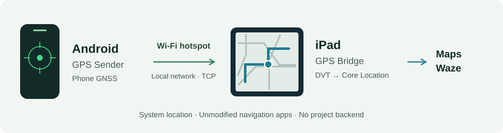
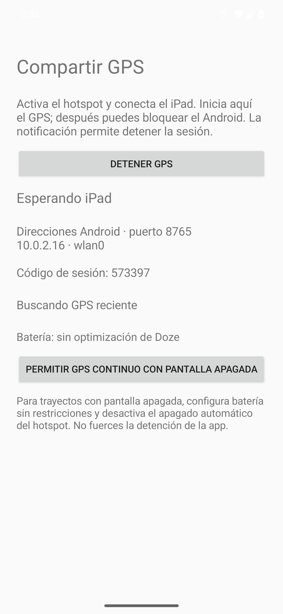
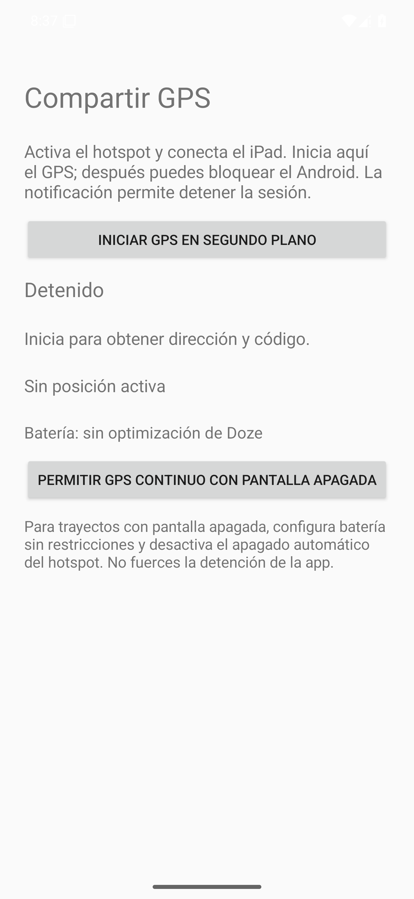

<h1 align="center">GPS Bridge</h1>

<p align="center"><strong>Your Android's GPS. Your iPad's maps.</strong></p>

<p align="center">
  <a href="https://github.com/pablo-exe/GPS-Ipad/actions/workflows/build.yml"></a>
  
  <a href="LICENSE"></a>
</p>

<p align="center">
  <a href="#download">Download</a> ·
  <a href="#first-time-setup">Setup guide</a> ·
  <a href="#everyday-use">Everyday use</a> ·
  <a href="#project-status">What's tested</a> ·
  <a href="#troubleshooting">Troubleshooting</a>
</p>



**GPS Bridge shares real Android GNSS coordinates with the iPad's system location service.** Maps and Waze receive the position through Core Location, using their normal, unmodified apps. The goal is to give an iPad a GPS source from the phone you already own—particularly useful for Wi-Fi-only models without built-in GNSS.

Two small native apps, a local connection, and **no jailbreak**. The iPad needs sideloading, Developer Mode, an RPPairing file, and LocalDevVPN. A computer is used for initial setup and installation; it is not part of the running GPS bridge.

> [!IMPORTANT]
> **Experimental project, still being validated.** The full Android → iPad → Maps/Waze flow was confirmed on a physical iPad with **v0.1 in the foreground**. v0.2 adds background sessions and automatic recovery; its software tests and Android emulator tests pass. **Extended v0.2 background use on a physical iPad alongside Waze/Spotify has not yet been verified.**

## Download

### Version 0.2.0

| App | Download | Requirements | Installation |
| --- | --- | --- | --- |
| **GPS Sender · Android** | [Download test APK](https://github.com/pablo-exe/GPS-Ipad/actions/runs/41124247447/artifacts/13009922067) | Android **13+**, GNSS, and a Wi-Fi hotspot | Debug-signed APK · about **35 KB** |
| **GPS Bridge · iPad/iPhone** | [Download unsigned IPA](https://github.com/pablo-exe/GPS-Ipad/actions/runs/41124247447/artifacts/13009402948) | iOS/iPadOS **18+**, arm64 device | Sign and sideload · about **1 MB** |

These links download **GitHub Actions ZIP archives**. Sign in to GitHub, extract the archive, and use the `.apk` or `.ipa` inside. The iOS artifact includes a SHA-256 checksum and third-party notices. Opening the IPA in Files does not install it: it must be signed first.

**Artifacts expire after 14 days.** If a link has expired, open [Build MVP](https://github.com/pablo-exe/GPS-Ipad/actions/workflows/build.yml), select a successful run, and find **Artifacts** at the bottom of its summary. If no current artifacts are available, use **Run workflow** if you have permission, or [build from source](#build-from-source).

**Update both apps together.** v0.2 uses protocol v2 and does not support the original v0.1 protocol.

## What it does

- **Android supplies GNSS.** The phone captures its position and serves it over the hotspot's local network.
- **The iPad receives system-level location.** The receiver uses Apple's DVT location simulation service through LocalDevVPN and `idevice`.
- **Background sessions are implemented.** Android uses a location foreground service with a notification; iPadOS uses a background location session. The bridge does not use audio playback to stay alive.
- **Connections recover automatically.** Android networking and DVT retry independently. Stale fixes and delayed replies are discarded.
- **No project backend.** Coordinates travel over your local network. These apps do not store a trip history.

## First-time setup

The current app UI is in Spanish. This guide includes English translations alongside the exact Spanish button labels.

### 1. Install both apps

**Android**

1. Download and extract **GPS-Sender-Android**.
2. Open `app-debug.apk`. Allow installation from that application if Android asks.
3. Open **GPS Sender**.

If Android rejects an update because its signature is different, stop GPS and uninstall the previous version before installing. Each CI runner uses its own debug signing key. The app does not store a route history that needs migrating.

**iPad**

1. Download and extract **GPS-Bridge-iOS-unsigned** on your computer.
2. Sign and install `GPS-Bridge-unsigned.ipa` with [Sideloadly](https://sideloadly.io/)—available for Windows and macOS—[SideStore](https://sidestore.io/), or your usual sideloading tool.
3. Follow the installer's instructions using your Apple account, then open **GPS Bridge** on the iPad.
4. Keep the app's signature valid. Provisioning, expiration, and refresh requirements depend on the installation method you choose.

**You do not need a Mac to try the artifacts:** GitHub Actions compiles the IPA on macOS, and you can sign it from Windows. Building iOS locally does require a Mac with Xcode.

### 2. Prepare the iPad's developer connection

This setup lets GPS Bridge communicate with developer services **on the same iPad**.

1. Enable **Settings → Privacy & Security → Developer Mode**, including the restart/confirmation if requested. If the option is missing, follow [Apple's Developer Mode guide](https://developer.apple.com/documentation/xcode/enabling-developer-mode-on-a-device) and complete the development-app installation.
2. Download [idevice_pair from its official Releases](https://github.com/jkcoxson/idevice_pair/releases) on Windows or macOS.
3. Connect the iPad over USB, unlock it, and accept **Trust This Computer**.
4. Generate a **Remote pairing / RPPairing** file for that exact iPad.
5. Transfer it privately to **Files** on the iPad. In GPS Bridge, enable **Inject into system location** (`Inyectar en la ubicación del sistema`), tap **Import RPPairing** (`Importar RPPairing`), and select it.
6. Install [LocalDevVPN from the App Store](https://apps.apple.com/app/id6755608044), approve its VPN configuration, and leave it connected.
7. Check the tunnel endpoint in GPS Bridge. The default is **`10.7.0.1:49152`**. Change it if your LocalDevVPN configuration uses another address or port.

> **RPPairing and Lockdown files are not interchangeable.** A Lockdown/SideStore pairing file cannot authenticate this connection. Export **Remote pairing / RPPairing**; renaming a file does not convert it. Pairing files contain authentication material: never upload them to the repository, an issue, or a public log.

If the tunnel connects but `LocationSimulation` is unavailable, the device's developer services or Developer Disk Image—DDI—may need preparing/mounting. Use Xcode or your usual developer tool; [StikDebug](https://github.com/StikDebug/StikDebug) is a reference in this ecosystem. **GPS Bridge does not mount DDI or perform pairing inside the app.** Having an RPPairing file alone does not prove DVT is ready.

### 3. Start the hotspot and Android sender

1. Enable **Wi-Fi hotspot / Internet sharing** on Android.
2. Connect the iPad to that network. Disable automatic hotspot shutdown if your phone offers it.
3. In GPS Sender, tap **Start background GPS** (`Iniciar GPS en segundo plano`).
4. Allow **precise location while using the app** and notifications. Enable the phone's system location/GPS setting too.
5. Tap **Allow continuous GPS with the screen off** (`Permitir GPS continuo con pantalla apagada`) and grant the battery-optimization exemption. Check any additional manufacturer-specific battery restrictions.
6. Note the **hotspot IP address** and **six-digit session code** shown in the app.

The ongoing notification identifies the active session and offers **Stop GPS** (`Detener GPS`). The service starts while the app is visible; it does not need Android's “Allow all the time” location permission. You can then lock the phone. **Android must remain powered on**, with its hotspot and GNSS active.

**More than one IP address?** Use the hotspot interface, not a VPN address. The **Router / Gateway** address in the iPad's Wi-Fi details can help identify the phone. There is no universal hotspot IP for all Android devices.

### 4. Test reception first

1. In GPS Bridge, enter the **Android IP address** and **session code**.
2. Allow **Local Network** and **location while using the app**. Location access also supports the receiver's background session.
3. Leave injection disabled and tap **Connect** (`Conectar`). If this opens the location permission prompt, grant access and tap Connect again.
4. Check that recent coordinates appear and the fix sequence number increases.
5. Repeat with **LocalDevVPN connected**: the iPad must still be able to reach Android over the LAN.

This isolates networking from injection. Reception can be tested without RPPairing or a DVT session. If no coordinates arrive here, check IP, permissions, hotspot, and GNSS reception first. For the first GNSS fix, try outdoors or near a window.

### 5. Enable system location injection

1. Tap **Stop and clear simulation** (`Detener y limpiar simulación`) to end the reception-only test.
2. Enable **Inject into system location** (`Inyectar en la ubicación del sistema`). Check RPPairing, the tunnel IP/port, and LocalDevVPN.
3. Tap **Connect** and check these three diagnostic levels:

| Diagnostic | What it proves |
| --- | --- |
| **Network: receiving recent GPS** (`Red: recibiendo GPS reciente`) | Valid Android fixes are reaching the iPad. |
| **DVT accepted position** (`DVT aceptó posición`) | The developer service accepted the coordinate command. |
| **Observed Core Location: software-simulated** (`Core Location observado: Simulada por software`) | The system is delivering a location marked as simulated. Also check that its coordinates match Android's. |

4. Open **Maps or Waze** and check that the position follows your movement. Observing the navigation app completes the test: receiving fixes and getting a successful DVT return are separate checks.

## Everyday use

Once setup is complete:

1. **Android:** enable the hotspot, start GPS Sender, and copy its session code.
2. **iPad:** join the hotspot, connect LocalDevVPN, and connect GPS Bridge with injection enabled.
3. Check recent fixes and Core Location, then **open Waze normally**. GPS Bridge can remain minimized. You can use Spotify without the bridge claiming an audio session.
4. **Lock Android or turn its screen off.** Keep the phone powered on and its hotspot running.
5. When finished, tap **Stop and clear simulation** on iPad and **Stop GPS** in Android or its notification. Check Maps and the cleanup result.

v0.2 does not require keeping a small receiver window visible. **Minimizing is different from force-quitting:** do not swipe GPS Bridge away in the iPad's app switcher. iPadOS may show its background location indicator.

If the OS kills a process, reopen and start the affected app. Recovery after force-stop is not promised. The receiver remembers the IP/tunnel settings and injection choice. The Android code stays valid for the service session; **stopping and starting the service creates a new code**. If the hotspot IP changes, update the receiver's address.

## Screenshots

<p align="center">
  
  
</p>

<p align="center"><em>First: Android service started. Second: session stopped. The current app UI is in Spanish.</em></p>

**Real API 35 emulator captures** from the v0.2 automated test. Data is synthetic, and the displayed code belonged to a test session that has ended. These are not iPad photos or visual evidence of Waze running on physical hardware. [Image provenance](docs/assets/README.md).

## Project status

Last documented verification: **October 30, 2026**.

| Scenario | Result | Evidence and scope |
| --- | --- | --- |
| Android → iPad → DVT → Core Location → Maps/Waze | **Confirmed on hardware** | Reported test with **v0.1 in the foreground**: movement/direction and stopping after connection loss. |
| v0.2 APK/IPA, protocol, and DVT recovery | **Automated tests passed** | [Verified workflow run](https://github.com/pablo-exe/GPS-Ipad/actions/runs/41124247447), commit `2f61fad`. DVT recovery uses a fake session in tests, not a physical iPad in CI. |
| v0.2 Android with screen off and forced Doze | **60/60 fresh samples** | API 35 emulator with battery exemption; also checks service/socket stop and CPU wake-lock release. |
| v0.2 iPad background use alongside Waze/Spotify | **Implemented; extended hardware test pending** | Continuous operation is not yet a verified claim. |
| Long sessions, iPad locking, and different iPadOS versions | **Pending** | Each device, OS, VPN, and signing combination needs checking. |

The **iPadOS 18+** minimum is a build target, not certification of every OS release: access to developer services can change. The IPA also targets the iPhone device family, but iPad is the use case currently being validated.

## Connection loss and recovery

| Situation | v0.2 behavior |
| --- | --- |
| TCP or Wi-Fi connection lost | Invalidates the fix, attempts DVT cleanup, and reconnects with **1, 2, 4, then up to 8 s** between failures. IP and code must still be correct. |
| GNSS missing, stale, or inaccurate | Stops injecting the last coordinate, waits for valid GNSS, and recovers DVT automatically. |
| DVT tunnel failure | Recovers separately from Android networking. Each new DVT session clears previous simulation before accepting fixes. |
| Delayed TCP response | Discards it rather than replaying queued coordinates. |
| DVT cleanup fails | Reports **unknown location state** and retries cleanup even without GNSS while the bridge session remains open. |
| Incorrect code | Stops attempts so you can correct the code. |
| Force-quit, reboot, or changed hotspot IP | Requires intervention: restart the affected app, check IP, and copy the new code when needed. |

**Freshness limit:** estimated total age below **2.5 s**, including Android capture age, the entire request RTT as a conservative transport bound, and time spent in the receiver. Duplicates do not refresh the fix. Android fixes must not be marked as mock locations, and horizontal accuracy must be **greater than 0 and no worse than 100 m**.

The iPad requests up to **2 fixes per second**; actual GNSS frequency depends on the phone. Replies taking over **1.5 s** are discarded, and unanswered requests time out after **2 s**. DVT calls use a **3 s timeout per operation** and run off the UI thread.

**Expiring a fix does not guarantee iPadOS has cleared it within the same deadline.** A blocking call, suspended/terminated process, or broken tunnel can delay or prevent cleanup. A point remaining in Maps does not prove the bridge is still injecting it. Use the recovery steps below if cleanup cannot be confirmed.

## Troubleshooting

| Problem | Check |
| --- | --- |
| No IP shown on Android | Enable the hotspot and start GPS Sender. Use the hotspot interface, not a VPN address. |
| No data reaches iPad | Same Wi-Fi, correct Android IP, current code, and **Local Network** permission. Try reception-only first, then repeat with LocalDevVPN enabled. |
| “Incorrect code” | Stop the iPad session and copy the code from the current Android service. Restarting that service changes its code. |
| Android keeps searching for GPS | System location/GPS enabled, **precise** permission, good GNSS reception, and unrestricted battery use. Old or inaccurate fixes are withheld. |
| Invalid RPPairing | Export **Remote pairing** for that exact iPad with `idevice_pair`. A Lockdown file or renamed extension will not work. |
| DVT will not connect | LocalDevVPN active, correct tunnel IP/port, Developer Mode, and the device's own RPPairing file. |
| `LocationSimulation` unavailable | Prepare developer services/DDI with Xcode or your developer tool. The bridge does not mount the image. |
| Stops after minimizing or locking | Check v0.2 on both sides, location permissions, Android's service/notification, battery exemption, and no force-quit. Physical iPad background continuity is still being validated. |
| DVT accepts but Maps does not move | Check **Observed Core Location**, coordinates, and the simulated flag. Try Maps and Waze separately; apps may reject software-simulated locations. |
| IPA will not install or stops opening | Valid signature/profile and a working sideloading method. Re-sign/refresh with your installer. This is not an App Store install. |
| APK update rejected | The debug signing key may have changed. Stop and uninstall the previous app before installing. |

### Recover an unknown location state

1. Restore **LocalDevVPN** and a recent Android fix.
2. Connect GPS Bridge, then tap **Stop and clear simulation**.
3. Check the DVT result and Maps. Accepted cleanup does not guarantee an immediate new physical fix on a Wi-Fi iPad without GNSS.
4. If cleanup cannot be confirmed or an old simulated position persists, **restart the iPad and check again**.

## Privacy and limitations

- Coordinates travel over **local TCP**. These apps have no project backend and do not store a trip history.
- The six-digit code limits casual connections; **TCP is not encrypted**. Use a protected hotspot and do not expose port **8765** to the Internet.
- RPPairing stays on the iPad: private copy, `0600` permissions, excluded from backup, and readable after first unlock to support a locked session.
- DVT receives **latitude and longitude**. Android accuracy is used for filtering/diagnostics, not forwarded as system accuracy. This method does not directly transmit speed, heading, or altitude.
- The system marks the location as **simulated by software**. Individual apps can interpret or reject it.
- The bridge does not extrapolate through tunnels or promise continuity after process termination. It is not an MFi GNSS receiver or an App Store distribution.

<details>
<summary><strong>Suggested hardware acceptance test</strong></summary>

Record exact Android device/OS, iPad/iPadOS, LocalDevVPN, Waze, and signing method. For v0.2, check:

- [ ] Reception and Core Location are correct before switching apps.
- [ ] GPS Bridge minimized with Waze/Spotify active for **20–30 minutes**, with movement and no audio-session takeover by the bridge.
- [ ] Android locked during the session, with its service/notification active.
- [ ] GNSS disabled/re-enabled: expiry, cleanup, and recovery.
- [ ] Wi-Fi/hotspot interrupted for 10–20 s: recovery with the same IP/code, or explicit correction if they changed.
- [ ] LocalDevVPN disconnected/reconnected: visible failure and DVT recovery.
- [ ] Stop from Android/notification and iPad; inspect Maps after each test.
- [ ] iPad locking, battery restrictions, and force-quitting checked separately.

</details>

## For developers

### Build from source

```sh
git clone https://github.com/pablo-exe/GPS-Ipad.git
cd GPS-Ipad
```

**Android · Windows, Linux, or macOS**

Install **JDK 17**, **Android SDK 35**, and **Gradle 8.11.1**. Configure the SDK for Gradle using `ANDROID_HOME` or `android/local.properties`. Android Studio is optional if you already have those tools.

```sh
cd android
gradle :app:assembleDebug :app:lintDebug
```

Output: `android/app/build/outputs/apk/debug/app-debug.apk`.

**iOS · macOS with Xcode**

From the repository root:

```sh
python3 scripts/prepare_ios_vendor.py
brew install xcodegen
cd ios
xcodegen generate
open GPSBridge.xcodeproj
```

Select your signing team in Xcode and run on a device. `prepare_ios_vendor.py` downloads the library, header, and module from a **pinned Locus commit**, verifying SHA-256. The FFI targets **arm64 devices**, not the simulator; no Rust compilation or 95 MB library blob in Git is needed.

The unsigned build command and IPA packaging steps are in [the Actions workflow](.github/workflows/build.yml). The IPA must be signed before installation.

### Architecture and tests

| Component | Responsibility |
| --- | --- |
| [`GpsService.java`](android/app/src/main/java/es/pablo/gpsbridge/GpsService.java) | GNSS, Android location foreground service, notification, and a partial CPU wake lock for the active session. |
| [`GpsServer.java`](android/app/src/main/java/es/pablo/gpsbridge/GpsServer.java) | Local TCP v2, authentication, latest fix, and replacement of old sockets. |
| [`ReceiverModel.swift`](ios/GPSBridge/ReceiverModel.swift) | Background location session, networking/reconnection, permissions, and diagnostics. |
| [`Protocol.swift`](ios/GPSBridge/Protocol.swift) | NDJSON framing, request matching, fix age, RTT, and a clock that includes suspension. |
| [`InjectionWorker.swift`](ios/GPSBridge/InjectionWorker.swift) | Serial injection, freshness, cleanup, and DVT recovery with isolated tests. |
| [`LocationEngine.swift`](ios/GPSBridge/LocationEngine.swift) | FFI adapter: RPPairing → tunnel → RSD → `LocationSimulation`. |

Protocol v2 answers **one outstanding request**, identified by `request_id`, with the latest available fix. It does not stream a queued route history. The previous protocol has been removed.

CI tests the server over real TCP with synthetic GNSS, the Swift parser/worker with a fake DVT session, Android Lint, and both builds. `android-runtime` installs the APK on an isolated API 35 emulator, starts it through the app button, forces Doze with the screen off, and checks 60 samples, shutdown, and CPU wake-lock release. Evidence is available in **Android-runtime-evidence** from the [verified run](https://github.com/pablo-exe/GPS-Ipad/actions/runs/41124247447).

Tests cover duplicates, delayed replies, expiry during a handshake or slow DVT set, disconnects, retry behavior, and failed cleanup. **CI does not run a physical iPad's DVT services or verify actual iPadOS suspension behavior.**

## Community

Tried it? [Open an issue](https://github.com/pablo-exe/GPS-Ipad/issues/new) with device models, exact versions, installation method, reproduction steps, and Network/DVT/Core Location diagnostics. Say whether the apps were foregrounded, backgrounded, or locked. Do not attach RPPairing, credentials, active codes, or personal locations.

Want to share the project? There is a [PNG cover and draft Twitter post](docs/COMMUNITY.md). The cover is a conceptual diagram; Android screenshots are real emulator captures. New reports help expand the compatibility matrix while keeping implemented features separate from verified behavior.

## Credits and license

- [Locus](https://github.com/ChrisMack32/Locus), for the adapted DVT connection sequence and the FFI distributed by its project.
- [idevice](https://github.com/jkcoxson/idevice) and [idevice_pair](https://github.com/jkcoxson/idevice_pair), for Apple device services and RPPairing creation.
- [LocalDevVPN](https://apps.apple.com/app/id6755608044), for the network path to the device itself.

**[MIT](LICENSE)**. Full attribution and provenance are in [THIRD_PARTY_NOTICES.md](THIRD_PARTY_NOTICES.md). Independent project, not affiliated with Apple, Google, Waze, Spotify, or the tools above.
