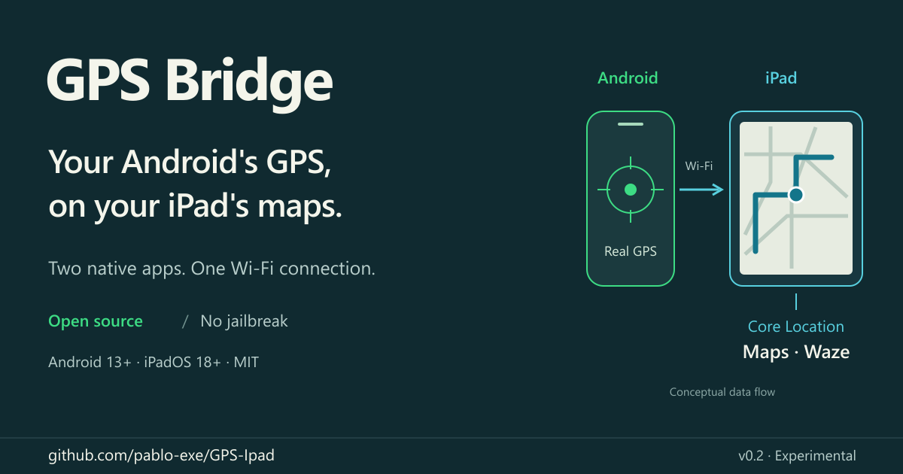

# Share GPS Bridge

Assets and copy for you to publish manually. No social post has been sent.

## Cover image



- [Download PNG, 1200 × 630](https://raw.githubusercontent.com/pablo-exe/GPS-Ipad/main/docs/assets/social-preview.png).
- [Editable SVG](assets/social-preview.svg).
- [Real emulator screenshots and image provenance](assets/README.md).

Suggested alt text: “GPS Bridge connects Android GNSS to an iPad's Core Location service over a Wi-Fi hotspot, letting Maps and Waze use that position. Conceptual diagram. Experimental open-source project.”

## Short post

```text
I built GPS Bridge: Android GNSS → iPad system location → Maps/Waze. No jailbreak.

Two tiny native apps, local Wi-Fi, open source. v0.2 adds background sessions + reconnection; extended iPad testing is still pending.

https://github.com/pablo-exe/GPS-Ipad
```

## Optional follow-up

```text
To try it: Android 13+, iPadOS 18+, LocalDevVPN, RPPairing and IPA sideloading.

Maps/Waze foreground use is confirmed on hardware. v0.2 passes recovery tests and 60/60 Android screen-off emulator samples. Looking for extended iPad background test reports.
```

Update these claims after verifying additional hardware combinations. Do not announce universal compatibility or uninterrupted road use as established facts. The cover is a diagram and the screenshots come from an emulator; they are not photos of a physical iPad test. The current app UI is in Spanish, as shown in the unmodified captures.
